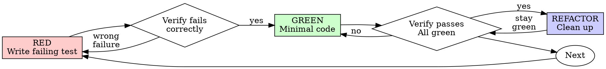

# Test-Driven Development (TDD)

## Overview

Write the test first. Watch it fail. Write minimal code to pass.

**Core principle:** If you didn't watch the test fail, you don't know if it tests the right thing.

**Violating the letter of the rules is violating the spirit of the rules.**

## When to Use

Use the cycle below for new or changed application behavior and bug fixes. For a behavior-preserving refactor,
first capture existing behavior with characterization tests; report it as characterization rather than inventing a bug.
Guidance, metadata and directory-only scaffold changes use static checks, not a manufactured application failure.
Respect an explicit execution exclusion and report missing evidence instead of asking for the same approval again.

## The Behavioral Rule

Observe a meaningful assertion fail for the intended behavior, implement the smallest repair, then observe it pass.
Missing imports, malformed fixtures and scaffolding errors do not establish a reproduced behavior defect.
Never delete existing production code or another worker's edits to satisfy a test-first ritual. If implementation
preceded the regression, preserve the work, recover a safe baseline when feasible and report the evidence honestly;
do not claim a historical RED phase that was not observed.

## Red-Green-Refactor



### RED - Write Failing Test

Write one minimal test showing what should happen.

<Good>
```typescript
test('retries failed operations 3 times', async () => {
  let attempts = 0;
  const operation = () => {
    attempts++;
    if (attempts < 3) throw new Error('fail');
    return 'success';
  };

  const result = await retryOperation(operation);

  expect(result).toBe('success');
  expect(attempts).toBe(3);
});
```
Clear name, tests real behavior, one thing
</Good>

<Bad>
```typescript
test('retry works', async () => {
  const mock = jest.fn()
    .mockRejectedValueOnce(new Error())
    .mockRejectedValueOnce(new Error())
    .mockResolvedValueOnce('success');
  await retryOperation(mock);
  expect(mock).toHaveBeenCalledTimes(3);
});
```
Vague name, tests mock not code
</Bad>

**Requirements:**
- One behavior
- Clear name
- Real code (no mocks unless unavoidable)

### Verify RED - Watch It Fail

**MANDATORY. Never skip.**

```bash
npm test path/to/test.test.ts
```

Confirm:
- Test fails (not errors)
- Failure message is expected
- Fails because feature missing (not typos)

**Test passes?** You're testing existing behavior. Fix test.

**Test errors?** Fix error, re-run until it fails correctly.

### GREEN - Minimal Code

Write simplest code to pass the test.

<Good>
```typescript
async function retryOperation<T>(fn: () => Promise<T>): Promise<T> {
  for (let i = 0; i < 3; i++) {
    try {
      return await fn();
    } catch (e) {
      if (i === 2) throw e;
    }
  }
  throw new Error('unreachable');
}
```
Just enough to pass
</Good>

<Bad>
```typescript
async function retryOperation<T>(
  fn: () => Promise<T>,
  options?: {
    maxRetries?: number;
    backoff?: 'linear' | 'exponential';
    onRetry?: (attempt: number) => void;
  }
): Promise<T> {
  // YAGNI
}
```
Over-engineered
</Bad>

Don't add features, refactor other code, or "improve" beyond the test.

### Verify GREEN - Watch It Pass

**MANDATORY.**

```bash
npm test path/to/test.test.ts
```

Confirm:
- Test passes
- Other tests still pass
- Output pristine (no errors, warnings)

**Test fails?** Fix code, not test.

**Other tests fail?** Diagnose and report them; repair caused or explicitly scoped failures, but do not repair unrelated code
or another worker's changes merely to obtain a green run.

A focused pass is not a full-suite pass. Run the owning package/repository's declared completion gates within the
authorized execution scope. Explicit no-execution, package, environment or hardware exclusions still apply; report
omitted gates rather than overriding them. Use actual native commands, not a generic bare `pytest`/`npm test` guess.
Report every observed failure by name, including pre-existing or unrelated failures; do not silently hide a red result.

### REFACTOR - Clean Up

After green only:
- Remove duplication
- Improve names
- Extract helpers

Keep tests green. Don't add behavior.

### Repeat

Next failing test for next feature.

## Good Tests

| Quality | Good | Bad |
|---------|------|-----|
| **Minimal** | One thing. "and" in name? Split it. | `test('validates email and domain and whitespace')` |
| **Clear** | Name describes behavior | `test('test1')` |
| **Shows intent** | Demonstrates desired API | Obscures what code should do |

When writing or changing any test, read [writing-good-tests.md](writing-good-tests.md) for the rules that keep tests honest:
- Name the production change that would make the test fail — before writing it
- Assert on real behavior, never on mock behavior
- Keep test-only code in test utilities, out of production classes
- Understand a dependency's side effects before mocking it

## Evidence gaps and safe recovery

| Situation | Required response |
| --- | --- |
| The behavior seems too small to test | Cover meaningful changed behavior and affected boundaries; prose/placeholders use static checks. |
| Implementation already exists | Preserve it and other workers' changes. Establish a safe baseline regression when feasible; do not claim a historical RED phase. |
| A new test passes immediately | Check its behavioral assertion and input. If a baseline failure was not observed, report characterization or the missing evidence honestly. |
| Manual testing was done | Record its actual scope; add a repeatable regression for changed behavior when authorized, without dismissing valid manual observations. |
| Exploration was necessary | Retain useful authorized work. Distinguish experiments, characterization and test-first evidence instead of deleting code for a ritual. |
| Testing requires broad setup | Inspect the affected responsibility and I/O seam before adding more mocks or an abstraction. |
| Existing code has no tests | Characterize the relevant behavior before preserving/refactoring it; do not rewrite unrelated code. |
| Execution is explicitly excluded | Do not run or invent results. Report the protecting assertion/check still required. |

Stop a completion claim when you cannot explain the observed failure, the assertion only checks a mock, important
error/lifecycle cases are missing, or the claimed RED phase was never observed. Resolve the evidence gap within scope;
this is not an instruction to restart the project, discard implementation or repeat already-granted approvals.

## Example: Bug Fix

**Bug:** Empty email accepted

**RED**
```typescript
test('rejects empty email', async () => {
  const result = await submitForm({ email: '' });
  expect(result.error).toBe('Email required');
});
```

**Verify RED**
```bash
$ npm test
FAIL: expected 'Email required', got undefined
```

**GREEN**
```typescript
function submitForm(data: FormData) {
  if (!data.email?.trim()) {
    return { error: 'Email required' };
  }
  // ...
}
```

**Verify GREEN**
```bash
$ npm test
PASS
```

**REFACTOR**
Extract validation for multiple fields if needed.

## Verification Checklist

Before marking work complete:

- [ ] Meaningful changed behavior and affected public boundaries have regression coverage
- [ ] Observed the intended RED/GREEN cycle, or accurately reported characterization / unavailable RED evidence
- [ ] Each test failed for expected reason (feature missing, not typo)
- [ ] Wrote minimal code to pass each test
- [ ] All tests pass
- [ ] Output pristine (no errors, warnings)
- [ ] Tests use real code (mocks only if unavoidable)
- [ ] Edge cases and errors covered

Unmet checks are verification gaps: resolve applicable gaps within scope or report them; never delete unrelated code.

## When Stuck

| Problem | Solution |
|---------|----------|
| Don't know how to test | Write wished-for API. Write assertion first. Ask your human partner. |
| Test too complicated | Design too complicated. Simplify interface. |
| Must mock everything | Code too coupled. Use dependency injection. |
| Test setup huge | Extract helpers. Still complex? Simplify design. |

## Debugging Integration

Bug found? Write failing test reproducing it. Follow TDD cycle. Test proves fix and prevents regression.

Protect changed behavior with a meaningful regression when execution is authorized; disclose any explicit exclusion.

## Final Rule

```
Behavior change → meaningful regression and observed evidence
Preserved behavior → characterization
Guidance/scaffolds → static verification
```

The task scope and recorded execution limits govern verification; this skill does not create another approval gate.
